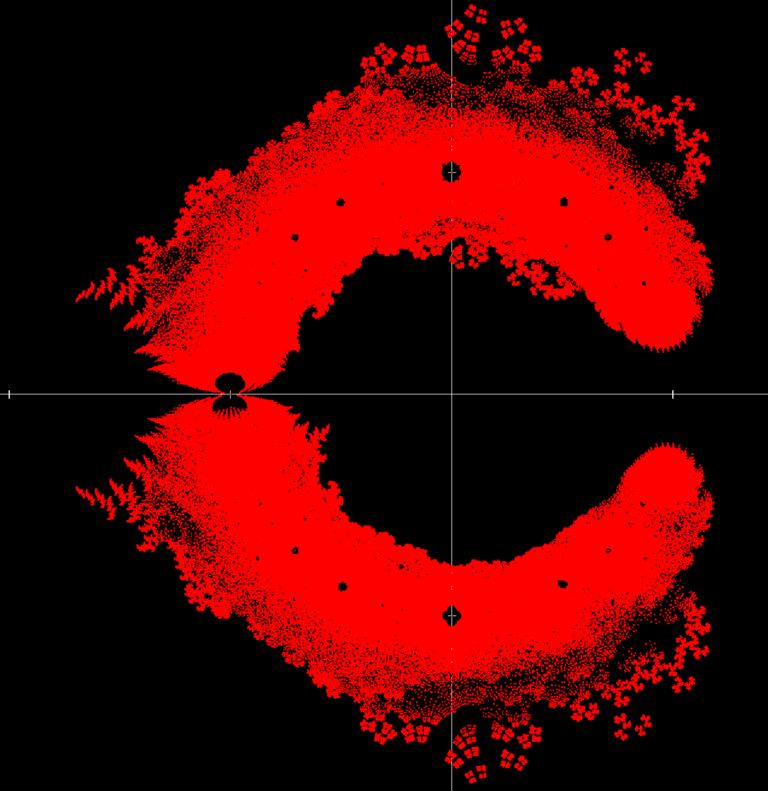
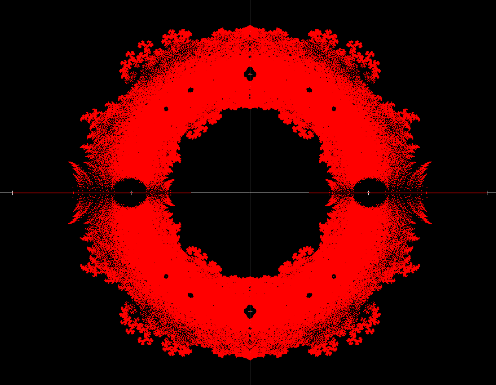
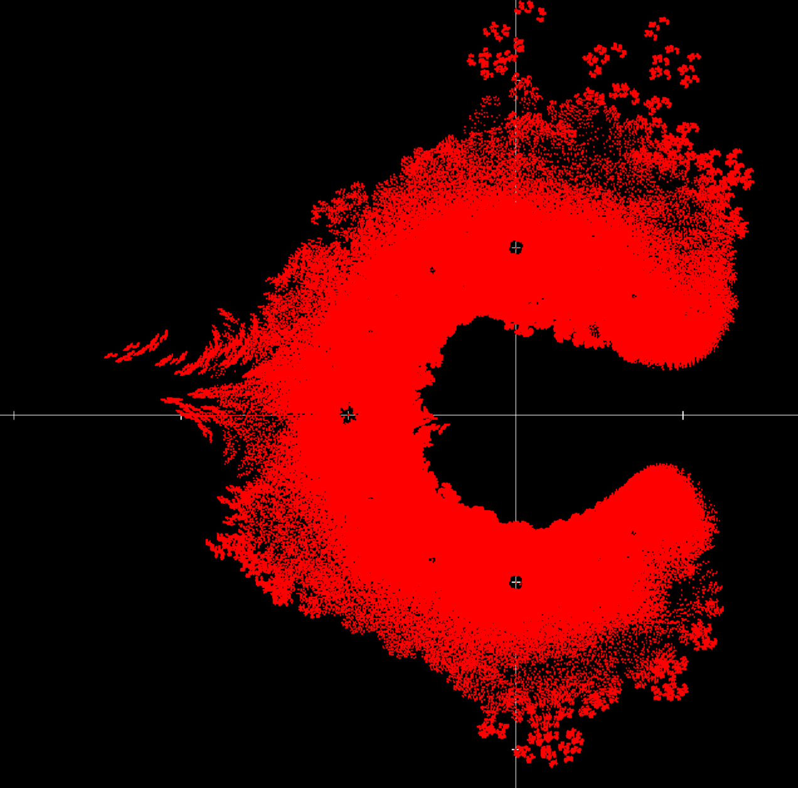
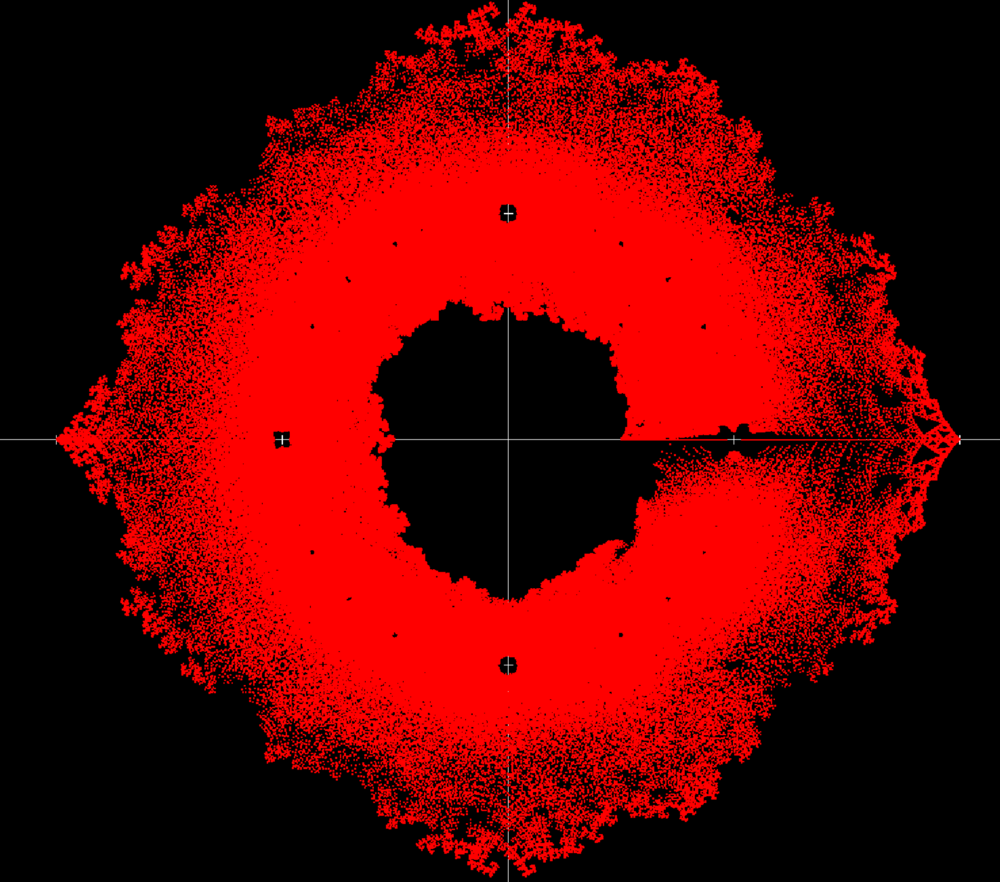

# Complex polynomial root visualizer

The program finds every root of $a_n z^n + a_{n-1} z^{n-1} + ... + a_1 z + a_0$, for every combination of $a_j \in A$, where $A$ is a predefined finite set and $n$ is given.

## Examples:
A={1, i}, n=15:

A={1, -1}, n=15:

A={1, 2, i}, n=10:

A={1, -1, i}, n=10:

A={ $-\frac{1}{2} + i\frac{\sqrt{3}}{2}, -\frac{1}{2} - i \frac{\sqrt{3}}{2}$ }, n=15:
_15.png)
